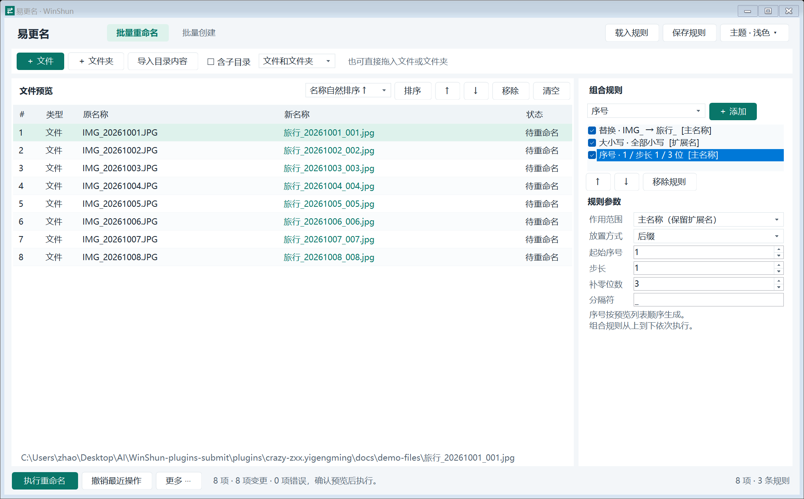
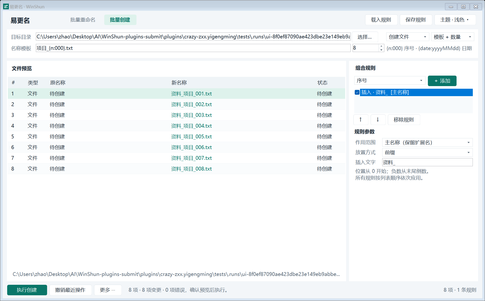

# 易更名

带中文窗口的文件和文件夹批量创建、重命名插件。支持顺序组合规则、实时预览、冲突检查、撤销与中断恢复，以及跟随系统/手动浅色或深色主题。

## 安装与启动

在 Win顺的插件设置中从社区 Release 安装 `crazy-zxx.yigengming-1.3.0.wsplugin` 并启用“易更名”。开发时将本目录放到 `%LOCALAPPDATA%\WinShun\plugins\crazy-zxx.yigengming\`，启用开发者模式。

- `br `、`rename `、`易更名 `、`批量重命名 `：打开重命名窗口，关键字后可附带文件或文件夹路径。
- `bc `、`批量创建 `：打开创建窗口，关键字后可附带已有目标目录。
- 窗口右上角“主题”可选跟随系统、浅色、深色；选择自动保存。

运行环境为 Windows 10/11、Windows PowerShell 5.1、.NET Framework 4.8，均不需要额外下载。单批最多 10000 项、最多 100 条规则。遵循传统 Windows 路径长度限制；跳过符号链接/联接点，带重解析点的 OneDrive 路径可能受限。

## 重命名操作

1. 拖入多个文件/文件夹，或点击“添加文件”“添加文件夹”。
2. 要处理目录内的项目，点击“导入目录内容”；可选递归子目录，以及仅导入文件、仅导入文件夹或两者都导入。
3. 使用自然名称排序、路径排序或 ↑ / ↓ 调整顺序。序号按照预览列表顺序生成，整批统一计数。
4. 在右侧添加规则，可添加任意数量的同类规则。选择规则编辑参数，用复选框启用/停用，用 ↑ / ↓ 调整规则顺序。
5. 检查新名称和状态；冲突、非法名称或源文件变化都会阻止执行。将鼠标移到行上可以查看完整路径或错误原因。
6. 点击“执行重命名”，核对项目数量后确认。

文件夹可以与其子文件夹、子文件同时加入，插件会计算最终父子路径。可以只改大小写，也可以互换名称或循环交换三个以上的名称。



## 规则与组合

每条规则接收上一条规则的输出，按列表从上到下执行。每条规则都可以单独指定作用范围：

- **主名称**：默认值。文件保留最后一个点后的扩展名；文件夹处理整个名称。
- **完整名称**：包含文件扩展名。
- **扩展名**：不包含点。对文件夹跳过；结果为空时移除扩展名。

`.gitignore` 这样的单点开头名称视为没有扩展名；`archive.tar.gz` 的最后扩展名是 `gz`。

| 规则 | 支持的参数与行为 |
|---|---|
| 序号 | 起始值、正/负/零步长、补零位数、前缀/后缀/指定位置/替换、分隔符 |
| 大小写 | 全大写、全小写、英文单词首字母大写、大小写反转 |
| 文字替换 | 普通文字全量替换，可忽略大小写；替换内容中的 `$1` 按普通文字处理 |
| 插入 | 前缀、后缀、指定位置或替换现有内容 |
| 随机字符 | 自定义字符集、1–128 位、前缀/后缀/指定位置/替换、分隔符 |
| 截取 / 删除 | 指定起点和长度，保留或删除该片段 |
| 正则匹配 | .NET 正则替换或提取；支持 `$1`、`${组名}`、`$0`，可忽略大小写 |
| 名称模板 | 当前名称、原始名称、原扩展名、原父目录、序号、日期 |
| 去除首尾空白 | 删除规则作用范围的首尾空白 |

位置从 **0** 开始，负数从末尾倒数。超出范围的起点会截到边界，截取长度会截到可用长度。位置以 .NET Unicode 文本元素计数，避免拆开普通 emoji 的 UTF-16 代理对。序号和随机规则的“分隔符”用于前缀与后缀模式。

正则未匹配时保留原内容。每次正则匹配有 200 毫秒超时保护，复杂表达式会报错而不是无限等待；编辑规则时会取消过期的预览任务。

随机值由本次窗口的随机种子、原路径和规则位置决定，常规预览刷新不会重新抽取；点击“更多 → 重新生成随机值”才会更换种子。执行使用已生成的目标名称。

### 示例：整理照片

将 `IMG_20261001.JPG` 变为 `旅行_20261001_001.jpg`：

1. 文字替换：主名称中查找 `IMG_`，替换为 `旅行_`。
2. 大小写：仅扩展名，全部小写。
3. 序号：主名称、后缀、起始 1、步长 1、3 位、分隔符 `_`。

`presets/照片整理.json` 可以直接通过“载入规则”使用。另附文件夹编号、随机后缀、正则日期整理、空白清理方案。载入会替换整个规则列表；保存会将完整规则顺序和参数写入 JSON。

### 模板变量

| 变量 | 含义 |
|---|---|
| `{name}` | 当前规则输入内容；在创建名称模板中为输入模板本身 |
| `{original}` | 原始主名称，不含原扩展名 |
| `{ext}` | 原始扩展名，不含点 |
| `{parent}` | 原始父目录名称 |
| `{n}` / `{n:000}` | 从 1 开始的全局序号，可设置数字格式 |
| `{date:yyyyMMdd}` | 日期；使用 .NET 日期格式，时间固定为本次窗口打开时的本地时间 |

名称模板规则的作用范围默认是“主名称”，所以通常不要再手动拼接 `.{ext}`。如果需要自己生成包括扩展名的完整名称，改选“完整名称”。

## 批量创建

切换到“批量创建”，选择**现有目标目录**、文件或文件夹，并选择输入方式：

- **模板 + 数量**：例如 `项目_{n:000}.txt`、数量 20，生成 `项目_001.txt` 至 `项目_020.txt`。
- **按行创建**：每行一个名称，忽略空白行；每行也支持序号和日期模板变量。

右侧规则同样作用于生成的名称，可继续组合替换、序号、大小写、随机字符等。创建的文件为空文件；给空文件添加 `.docx` 等后缀不会生成对应文档的内部格式。不会通过名称创建子路径，名称中的 `\`、`/` 会报错。



## 撤销、恢复与数据

- “撤销最近操作”可撤销最近一批已完成操作，支持跨窗口、跨启动保存；连续点击可逐批撤销更早的操作。
- 重命名的撤销使用文件系统标识检查项目是否被替换，不会覆盖后来在原位置新建的项目。同一文件在原位置修改内容后仍可撤销名称。
- 撤销创建时，整批项目必须仍然存在、标识一致且内容为空；有内容的文件或文件夹会导致拒绝自动删除。不会递归删除目录。
- 重命名先将源项目移到同目录下的私有暂存名称，再移到最终名称，以处理名称互换、大小写和父子目录。失败时按相反顺序回滚。
- 每次文件移动前记录并刷盘追加日志；大批次不会在每次移动时重写整个批次快照。完成后保存完整事务快照。
- 若 WinShun 被退出、程序被结束或掉电，重新打开窗口后点击“更多 → 恢复中断操作”。未恢复的事务会阻止新操作。遇到外部占用或文件替换时会保留日志并显示原因，供手动核对。
- 存储设备故障或文件被其他程序改动时，回滚可能需要人工处理；恢复日志会保留已知原路径、目标路径、暂存路径和文件标识。创建暂存项与第一次记录其标识之间若恰好中断，会要求人工核对该暂存项。

宿主运行时使用 `initialize.params.dataDir` 作为数据目录。独立运行时默认使用：

```text
%LOCALAPPDATA%\WinShun\plugins\crazy-zxx.yigengming.data\
  operations.lock
  theme.txt
  transactions\<事务ID>.json
  transactions\<事务ID>.jsonl
```

JSON 保存事务快照，JSONL 保存追加的恢复事件。不要单独删除某个事务的 JSONL。历史记录只在该数据目录保留，移除数据目录后无法跨启动撤销。窗口中的“更多 → 导出预览 CSV”可另行保存原路径与目标路径清单。

## 运行实现与权限

入口是 UTF-8 BOM 的 `main.ps1`，只使用 Windows 自带组件。本目录不包含 EXE/DLL、预编译缓存、下载器或混淆代码。启动时通过 .NET CodeDOM/CSharpCodeProvider 调用系统 C# 编译器，将可审查的 `src/*.cs` 编译成临时托管类库，在当前 PowerShell 进程的独立 AppDomain 中加载；临时文件在退出后清理。AppDomain 使用 `runtime.config` 保留 .NET 4.8 的高 DPI 配置。编译器会短暂启动子进程；工作窗口随后在同一常驻 PowerShell 进程的 STA 线程运行。

| 权限 | 用途 |
|---|---|
| `ui` | 显示 WinForms 工作窗口、系统文件选择器和确认提示 |
| `files:read` | 读取用户选择的项目、目录内容、规则方案和恢复日志；读取 Windows 应用主题设置 |
| `files:write` | 执行用户确认的重命名/创建/撤销/恢复，保存规则、主题、事务日志和用户选择的 CSV 导出 |
| `clipboard:read`、`clipboard:write` | Windows 标准文本编辑控件的复制和粘贴；不主动扫描剪贴板 |
| `processes` | 仅本地 CodeDOM 编译所需的系统 C# 编译器子进程；不下载或启动外部工具，也不为窗口另开进程 |

不申请 `network`，不进行任何联网请求，不发送文件名、路径或内容。使用自己的 JSON-RPC 实现，未依赖或导入 WinShun PowerShell SDK。源代码采用 MIT，保留原版权声明。

## 独立运行与验证

```powershell
powershell -NoProfile -ExecutionPolicy Bypass -File .\main.ps1 -Ui
python tests/protocol_test.py
powershell -NoProfile -ExecutionPolicy Bypass -File .\main.ps1 -Validate -Screenshot .\docs\create-preview.png
```

Python 3 仅用于协议测试，不是运行依赖。`-Validate` 编译测试源码，并在相同 AppDomain/DPI 配置下执行规则、真实临时文件和实际控件检查。测试不会批量修改用户文件。仓库规范检查在仓库根目录执行 `python tools/check.py`。详细结果见 [验证记录](docs/TEST-REPORT.md)。
